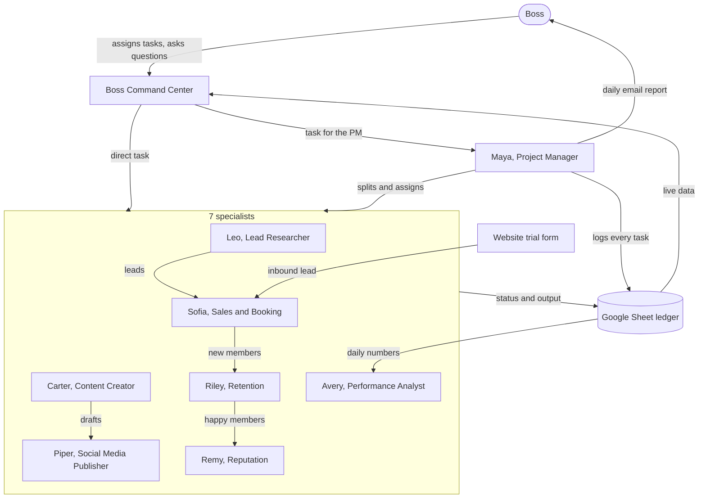

# FitPulse AI: an autonomous AI agency for fitness clubs

FitPulse AI is a Fitness Club Growth Agency run by 8 autonomous AI employees: 1 Project Manager and 7 specialists. The Boss manages them from a hosted dashboard, the **Boss Command Center**: assign tasks, watch every task live, read reports, and chat with the Project Manager or any employee.

The team is hired from the [ai-employees](https://github.com/markfulton/ai-employees) repository with its official installer. Every task is written to a Google Sheet ledger, and the Project Manager emails a status report every day.

## The team

| # | Employee | Role | ai-employees kit | Main output |
|---|---|---|---|---|
| 1 | Maya | Project Manager (Chief of Staff) | `chief-of-staff` | Task assignments, ledger, daily email, chat answers |
| 2 | Leo | Lead Researcher | `gtm-engineer` | Leads with name, company, source, status |
| 3 | Sofia | Sales and Booking Agent | `sales-employee` | Follow-up messages, trial bookings |
| 4 | Carter | Content Creator | `seo-employee` | Post drafts |
| 5 | Piper | Social Media Publisher | `social-media-employee` | Published posts, posts waiting for approval |
| 6 | Riley | Retention Specialist | `customer-satisfaction-employee` | Win-back messages, renewal reminders |
| 7 | Remy | Reputation Manager | `web-dev-employee` | Review replies, review requests |
| 8 | Avery | Performance Analyst | `ad-manager-employee` | Daily insights, bottleneck flags |

Roles, inputs, outputs, tools, KPIs and the daily routines are defined in [`agency/team.json`](agency/team.json).

## Workflow



## Architecture

```
Browser (Boss)  ->  Node.js server (server/)            ->  LLM API (Gemini, Anthropic or OpenAI-compatible)
                     - login, tasks, board, reports
                     - worker: employees do their tasks  ->  Telegram Bot API (optional released channel)
                     - Project Manager chat
                     - schedule of daily routines        <-> Apps Script web app (bridges/apps-script/Code.gs)
                                                              - Google Sheet ledger (5 tabs)
                                                              - daily email (MailApp) and time triggers
```

- **No dependencies.** The server is plain Node.js 20+, the dashboard is plain HTML, CSS and JavaScript.
- **The Google Sheet is the database of record.** Every task, lead, post, output and chat message is written to it. After a restart the server restores everything from the sheet, so free hosts with no disk are fine.
- **Real data only.** The dashboard, the reports, the email and the chat all read the same store. The Project Manager answers from a snapshot of that store. Leads are recorded only when they come from the website form or from web search results with a source URL.
- **Guardrails from ai-employees.** Publishing goes only to a released channel (Telegram, when its token is set). Every other post waits for the Boss to approve it in Reports.

### Automation bridges

| Bridge | File | What it does |
|---|---|---|
| Sheets | `server/sheets.mjs`, `bridges/apps-script/Code.gs` | Upserts rows into the tabs Ledger, Leads, Posts, Outputs, Chat. Restores the store from the sheet |
| Email | `bridges/apps-script/Code.gs`, `server/reports.mjs` | A daily trigger asks the server for the report and sends it with MailApp. "Email report now" in the dashboard does the same on demand |
| Dashboard | `server/index.mjs`, `public/` | The five modules: task assignment, live board, reports, chat, employee overview |
| Chat | `server/pm.mjs` | Answers from live data and creates tasks. Works with an LLM, and falls back to built-in answers without one |

Ledger columns: Task ID, Timestamp, Assigned By, Agent Name, Task Description, Priority, Status (Queued / In Progress / Blocked / Completed), Output / Result Link, Completion Time, then Title, Deadline, Duration, Blocked Reason.

## Setup

Requirements: Node.js 20 or newer, Git, a Google account, one LLM API key.

### 1. Hire the team

```bash
npm run hire
```

This clones ai-employees into `vendor/`, runs its installer for all 8 kits into `agency/employees/`, writes an `AGENCY-ROLE.md` for each employee, and writes the team manifest `agency/.installed.json`. Each kit folder also gets its own `.installed.json` receipt from the installer. Keep the project outside OneDrive, Dropbox, Google Drive and iCloud folders: the installer refuses synced folders.

### 2. Create the Google Sheet ledger and the email bridge

1. Create a Google Sheet. Open Extensions > Apps Script and paste `bridges/apps-script/Code.gs`.
2. Fill in `CONFIG`: a secret of your choice, the public URL of the dashboard (after step 4), your email, the hour of the daily report.
3. Deploy > New deployment > Web app. Execute as: Me. Who has access: Anyone. Copy the web app URL.
4. After the dashboard is online, run `setupTriggers` once from the editor. It creates the daily email trigger and a 10 minute tick that keeps the agency working.

### 3. Run locally

```bash
cp .env.example .env     # then fill in the values
npm start                # http://localhost:3000
npm test                 # end-to-end check with stand-ins, no keys needed
```

### 4. Deploy

Any Node host works. On Render: New > Web Service > connect this repository. Build command: `echo no build step`. Start command: `node server/index.mjs`. Add the variables from `.env.example` under Environment. `render.yaml` describes the same service as a Blueprint.

After the first deploy, set `PUBLIC_URL` to the address the host gave you, put the same address into `CONFIG.SERVER_URL` in the Apps Script, redeploy the web app, and run `setupTriggers`.

### Environment variables

| Name | Purpose |
|---|---|
| `BOSS_USERNAME`, `BOSS_PASSWORD` | The only login of the dashboard |
| `SESSION_SECRET` | Signs the session cookie |
| `PUBLIC_URL` | Public address, used in ledger result links and the email |
| `TIMEZONE` | Time zone for "today", reports and routines, for example `Europe/Kyiv` |
| `GEMINI_API_KEY` or `ANTHROPIC_API_KEY` or `OPENAI_API_KEY` | The model the employees think with. `LLM_MODEL` picks a model |
| `SHEETS_WEBAPP_URL`, `BRIDGE_SECRET` | The Apps Script web app and its shared secret |
| `SHEET_URL` | Link to the sheet, shown in the dashboard |
| `BOSS_EMAIL` | Address for "Email report now" |
| `CLIENT_NAME`, `CLIENT_CITY`, `CLIENT_INFO` | The club the agency works for |
| `TELEGRAM_BOT_TOKEN`, `TELEGRAM_CHANNEL` | Optional released publishing channel |
| `AUTOPILOT` | `false` turns the daily routines off |

## Dashboard modules

- **Team:** a card for each of the 8 employees with role, current task, active or idle, and today's output count.
- **Assign task:** title, description, employee, priority, deadline. The employee picks the task up and moves it through its statuses on its own.
- **Live task board:** every task by status, with filters by employee, status, priority and date. Click a task for details, output and timestamps.
- **Reports:** per-employee and agency reports, daily and weekly, KPI charts, leads and posts with details, CSV export, Save as PDF, Email report now.
- **Chat:** the Project Manager and every employee. History is saved. The chat can create tasks.
- **Public trial form** at `/join`: every request becomes a lead and a follow-up task for Sales.

## Project layout

```
agency/team.json            the 7+1 team: roles, KPIs, routines
agency/.installed.json      team manifest written by npm run hire
agency/employees/<kit>/     hired ai-employees kits, each with .installed.json and AGENCY-ROLE.md
bridges/apps-script/Code.gs Google Sheets and email bridge
server/                     index (HTTP), agents (worker, schedule), pm (chat), reports, sheets, store, llm, config
public/                     dashboard and the public trial form
scripts/hire-team.mjs       hires the team
scripts/smoke-test.mjs      end-to-end test
```

## Credits

The employee kits come from [ai-employees](https://github.com/markfulton/ai-employees) by Mark Fulton, MIT License.
